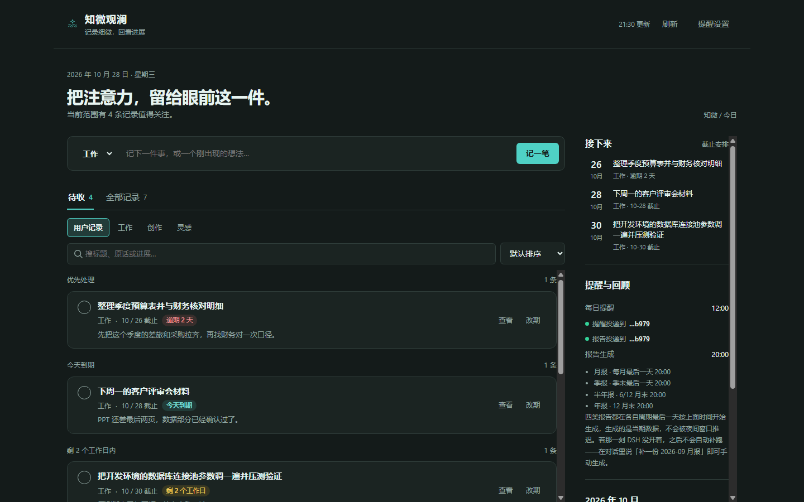
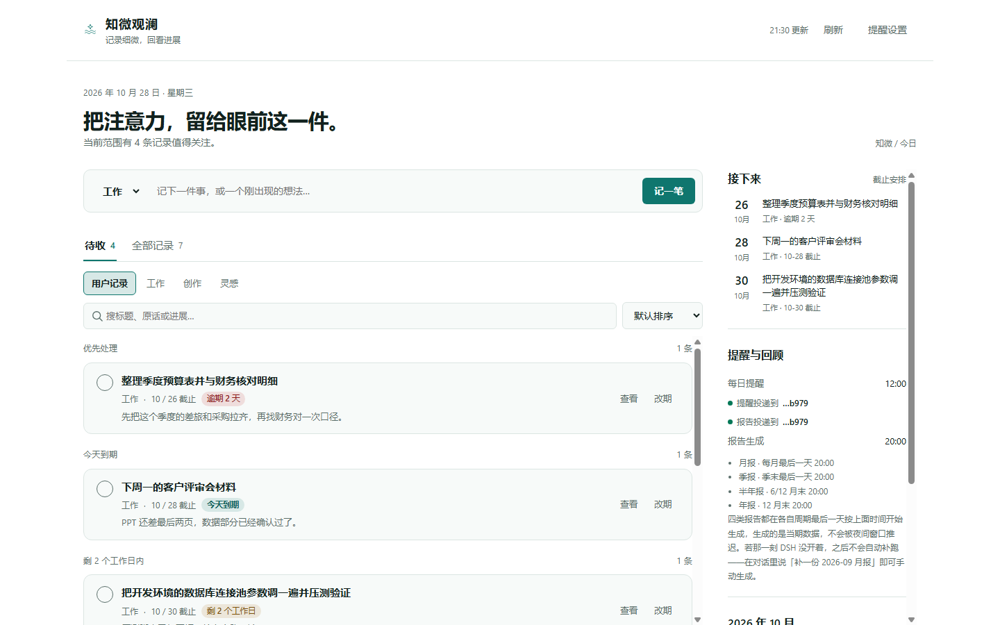
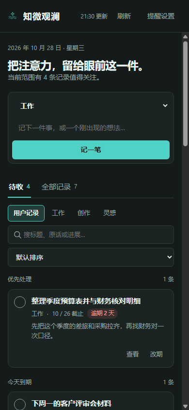

<div align="center">

# 知微观澜

**把注意力，留给眼前这一件。**

一个 DSH 插件：你说一句，它记一条；到点提醒；按周期出回顾。

</div>



---

## 它解决什么

日常里真正难的不是"记住所有事"，而是**在合适的时候想起该做的那一件**。

知微观澜只做三件事：

- **记**：一句话落成一条记录，你的原话一字不改留在时间轴上。
- **提**：每天固定时间，只告诉你"接下来该收哪一件"，不做长篇回顾。
- **看**：月末/季末/年末，把这段时间的进展算成事实，再写成一篇回顾。

它不做待办清单的加减法——停滞、逾期、沉睡这些"细微处"才是它盯着的东西。名字取"见微知著、观水之澜"。

## 四个域

记录分四类，各有各的形态，共用一套引擎：

| 域 | 适合记什么 | 一条记录的形态 |
|---|---|---|
| **工作** | 有始有终的事项 | 有期限、可标完成 |
| **创作** | 需要推进的项目 | 分阶段（构想/起草/修订/完成/搁置） |
| **灵感** | 冒出来还不想动的想法 | 只追加不合并，久不动会"沉睡" |
| **助手** | 你自己的开发日志 | 给插件本身用，默认不进报告 |

## 装

在 DSH 的 profile 里指到本地目录。编辑 `~/.dsh/profiles/desktop/package.json`：

```json
{
  "dependencies": {
    "dsh-secretary": "link:E:/你的路径/dsh-secretary"
  },
  "dsh": {
    "profile": {
      "bundles": [
        "@deepseek-ai/dsh-base",
        "@deepseek-ai/dsh-web-app",
        "dsh-secretary"
      ]
    }
  }
}
```

`link:` 后面写你 clone 下来的目录，`bundles` 里加上 `dsh-secretary`，重启 DSH 即可。左侧栏会出现「知微观澜」。

装了之后**不用配置**就能用：数据默认存在 `~/.dsh/plugin-data/dsh-secretary`，首次启动自动建目录。想换到 Obsidian 库，见[使用说明](docs/使用.md#数据在哪)。

## 用

### 记一条

面板顶部输入框，选好域，写一句就行。或者直接在对话里说：

> 下周三之前把方案发给张明

它会问清楚期限（没有期限就不能提醒你），然后落成一条记录。

**它不会改写你的话。** 你说什么，时间轴上就是什么；系统自己的解读另起一行，永远不覆盖原文。

### 被提醒

每天 12:00（可改），它发来一条消息，只说当前最该处理的几件，按紧迫程度排：

- 逾期了几天
- 今天到期
- 还剩两个工作日内
- 停滞太久（工作 5 天、创作 10 天没动）
- 沉睡的灵感（30 天没管）

### 看回顾

月末、季末、年末各出一次报告。**代码算事实，模型写解读**——数字不会由模型编。

四类周期，没有周报：

| 周期 | 什么时候出 |
|---|---|
| 月度 | 每月最后一天 20:00 |
| 季度 | 3/6/9/12 月最后一天 20:00 |
| 半年度 | 6 月末、12 月末 20:00 |
| 年度 | 12 月末 20:00 |

到点就投递，不会被"夜间窗口"推迟。**错过不补**——那时 DSH 没开着，之后不会自动补跑，但会在面板上标出来；想补就说「补一份 2026-09 月报」。

### 面板

| 浅色 | 窄屏 |
|---|---|
|  |  |

- 深浅主题跟随 DSH，颜色走语义令牌，对比度按 WCAG 校准
- 宽度按**插件容器实际宽度**重排，不是按浏览器窗口——侧栏展开、右侧栏打开都会正确换行
- 页签支持 `←/→/Home/End` 键切换

## 常见问题

**数据在哪？会被上传吗？**
在 `~/.dsh/plugin-data/dsh-secretary`，是普通的 Markdown 文件，你可以直接用 Obsidian 打开、用 git 版本控制。没有任何上传行为。

**能改成别的提醒时间吗？**
能。说「提醒改到早上 9 点」，或直接改 `系统/调度.json`，改完立即生效。

**为什么新建记录非要我填期限？**
没有期限就无法在到期前提醒，这条记录会变成永远不响的哑炮。确实不急的话说一声"不急"，它会标为无期限（7 天不动会按停滞提醒）。

**报告会不会把不同领域混在一起？**
不会。各域分开存放，助手域默认不参与汇总。

**它和普通待办应用有什么不同？**
普通待办关心"做完了没"，它关心"多久没动了"。停滞和沉睡是它的一等公民。

## 文档

- **[使用说明](docs/使用.md)** — 记录形态、判重规则、报告口径、会话绑定、加自定义域
- **[开发说明](docs/开发.md)** — 目录结构、热重载原理、测试清单

## 许可

[MIT](LICENSE) © 2026 熊博明

随便用、随便改、随便分发，商用也行。只要求保留版权声明。

## 参与

- 用着有问题、或者想要什么功能：[Discussions](https://github.com/xboming/dsh-secretary/discussions)
- 确定是 bug：[Issues](https://github.com/xboming/dsh-secretary/issues)
- 想改代码：[开发说明](docs/开发.md) 里有目录结构、热重载原理和完整测试清单
