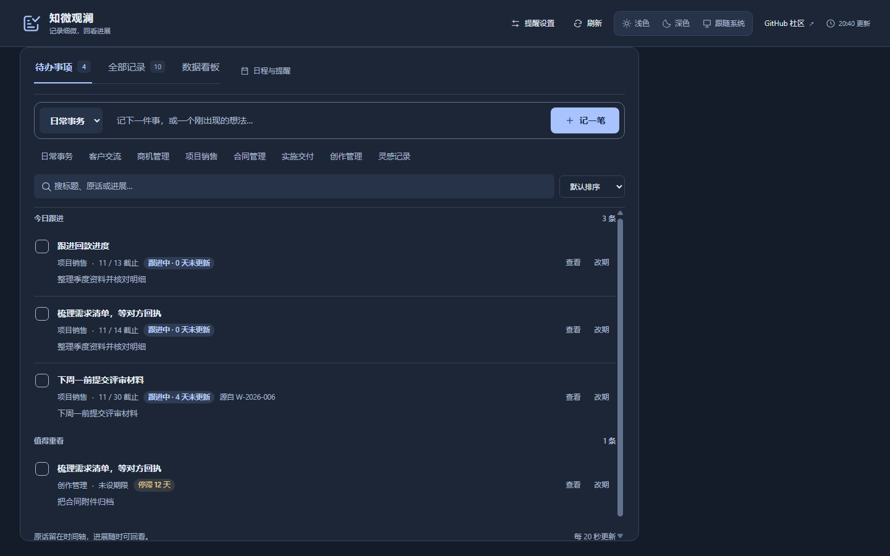
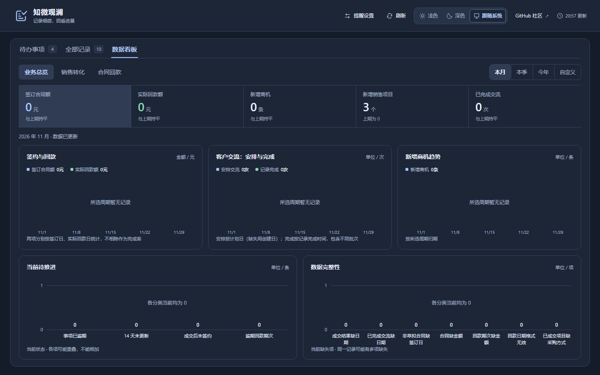
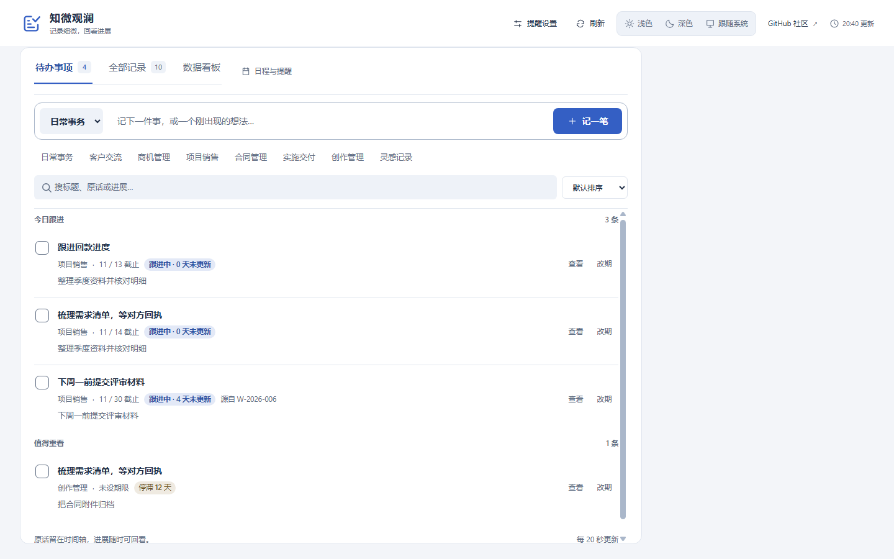

<div align="center">

# 知微观澜

**把注意力，留给眼前这一件。**

一个 DSH 插件：你说一句，它记一条；到点提醒；按周期出回顾。

</div>



---

## 它解决什么

日常里真正难的不是"记住所有事"，而是**在合适的时候想起该做的那一件**。

知微观澜只做三件事：

- **记**：一句话落成一条记录，你的原话一字不改留在时间轴上。
- **提**：每天固定时间，只告诉你"接下来该收哪一件"，不做长篇回顾。
- **看**：月末/季末/年末，把这段时间的进展算成事实，再写成一篇回顾。

它不做待办清单的加减法——停滞、逾期、沉睡这些"细微处"才是它盯着的东西。名字取"见微知著、观水之澜"。

## 九个域

记录分九类，各有各的形态，共用一套引擎：

| 域 | 适合记什么 | 状态 |
|---|---|---|
| **日常事务** | 没有客户、没有金额，但要办完的事 | 待办 / 进行中 / 已完成 / 已放弃 |
| **客户交流** | 拜访记录 | 待拜访 / 已拜访 / 已取消 |
| **商机管理** | 还没确定要做的早期线索 | 线索 / 接触中 / 跟进中 |
| **项目销售** | 确定要投的标 | 初期阶段 / 方案报价 / 招采阶段（另有一条"是否中标"的轴） |
| **合同管理** | 签下来的合同与回款 | 草拟 / 已签订 / 履行中 / 已完成 / 已解除 |
| **实施交付** | 中标后的交付过程 | 待启动 / 实施中 / 验收中 / 已验收 / 已终止 |
| **创作管理** | 需要推进的项目 | 构思 / 起草 / 修订 / 完成 / 搁置 |
| **灵感记录** | 冒出来还不想动的想法 | 只追加不合并，久不动会"沉睡" |
| **助手备忘** | 在 DSH 里做任何事踩过的坑 | 只记约束，没有完成和改期 |

前八个是内置域。「助手备忘」需要自己在 `系统/域.json` 里加，不配就没有。

它值得单独说一句，因为它的用法和别的域都不一样：**范围是「在 DSH 里做任何事踩过的坑」，
不只这个插件**——写插件、改配置、调宿主服务、跑脚本、处理数据都算。判据是
**换个项目还会不会遇到**。

它**没有完成、没有改期、不进报告**，唯一的价值是**被模型在动手前主动查询**：
遇到破坏性操作、编码/路径/权限问题、要调宿主服务时，先搜一遍有没有已知坑，
而不是重新试错一遍。所以你写进去的每条记录，都应该带一句"下次遇到 X 就做 Y"。

前六个串成一条链：**事务/客户交流 → 商机 → 项目销售 → 合同 → 实施**。
谈出眉目用 `secretary_link` 转过去，来源记录保留并标注去向，历史原话带过去。

记账口径：一条商机一个文件，跟踪记录**追加进同一条的时间轴**，不另建条目；
中标金额与利润入库，利润率由两者现算、不单独存；合同金额与中标金额是两个数，不合并；
回款进度与回款状态同样现算。客户台账是**自动聚合视图**（中标/未中标来自项目销售，
交流记录来自客户交流），不另存一份。

**事务域不叫「工作」是刻意的**：实测三条记录里两条转成了商机，
说明用户实际的"工作"八成落在销售链条上。叫"工作"会让每次记录都要纠结放哪个域。
判据只有一条——**有没有客户和投标过程**：有就进销售链，没有才进事务。
（域 id 仍是 `work`、目录是 `01-日常事务/`。）

## 装

在 DSH 的 profile 里指到本地目录。编辑 `~/.dsh/profiles/desktop/package.json`：

```json
{
  "dependencies": {
    "dsh-secretary": "link:E:/你的路径/dsh-secretary"
  },
  "dsh": {
    "profile": {
      "bundles": [
        "@deepseek-ai/dsh-base",
        "@deepseek-ai/dsh-web-app",
        "dsh-secretary"
      ]
    }
  }
}
```

`link:` 后面写你 clone 下来的目录，`bundles` 里加上 `dsh-secretary`，重启 DSH 即可。左侧栏会出现「知微观澜」。

装了之后**不用配置**就能用：数据默认存在 `~/.dsh/plugin-data/dsh-secretary`，首次启动自动建目录。想换到 Obsidian 库，见[使用说明](docs/使用.md#数据在哪)。

## 用

### 记一条

面板顶部输入框，选好域，写一句就行。或者直接在对话里说：

> 下周三之前把方案发给张明

它会问清楚期限（没有期限就不能提醒你），然后落成一条记录。

**它不会改写你的话。** 你说什么，时间轴上就是什么；系统自己的解读另起一行，永远不覆盖原文。

后续进展也是这样——**同一件事始终是一条记录**，新写的跟进追加进它的时间轴。
商机不必新建条目来记"今天又聊了什么"：阶段变了拉一下阶段下拉，时间轴会自动留一条；
想说明原因就写在上面。点开任何一条记录，看到的就是按时间倒序排着的原话。

### 被提醒

每天 12:00（可改），它发来一条消息，只说当前最该处理的几件，按紧迫程度排：

- 逾期了几天
- 今天到期
- 还剩两个工作日内
- 停滞太久（各域阈值不同：日常事务 5 天、创作 10 天、实施 15 天、合同 20 天）
- 沉睡的灵感（30 天没管）

阈值写在 `系统/域.json` 里，每个域可以单独调。

### 看回顾

月末、季末、年末各出一次报告。**代码算事实，模型写解读**——数字不会由模型编。

四类周期，没有周报：

| 周期 | 什么时候出 |
|---|---|
| 月度 | 每月最后一天 20:00 |
| 季度 | 3/6/9/12 月最后一天 20:00 |
| 半年度 | 6 月末、12 月末 20:00 |
| 年度 | 12 月末 20:00 |

到点就投递，不会被"夜间窗口"推迟。**错过不补**——那时 DSH 没开着，之后不会自动补跑，但会在面板上标出来；想补就说「补一份 2026-09 月报」。

### 从商机到回款

前六个域串成一条链，每一步都不用重填：

```
日常事务 / 客户交流
   ↓ 谈出眉目（secretary_link）
商机管理（线索 → 接触中 → 跟进中）
   ↓ 确定要投（拿到招标文件或对方明确直签）
项目销售（阶段 + 是否中标，两条轴分开记）
   ↓ 收到成交通知书
合同管理（金额、期次、补充协议）
   ↓
实施交付（按期的回款计划）
```

**几个刻意的设计**：

- **中标金额和合同金额是两个数**，不合并。谈条款被砍价、暂列金另算、只签一个标段，都会让两者不等。
- **利润率不入库**，由中标金额和利润现算。存了它就是冗余，改了金额忘改利润率，两个数会静默打架。
- **回款进度、回款状态、逾期天数全部现算**，道理同上。
- **补充协议只有"已签收"才计入合同总额**，避免金额虚高。
- **合同解除时实施项目自动转已终止**，单向联动；反过来不成立。

### 数据看板

面板顶部切到「数据看板」，是跨域的全局视角：按时间窗口看各项工作、资金的进来与出去、
以及各域的工作量与完成率。



**业务总览 / 销售转化 / 合同回款**三组视图；时间范围可选本月/本季/今年/自定义；
销售阶段与成交结果支持按数量或按金额切换口径。

图表用真实的计算数据绘制，**数字与报告同源**——不是另算一套。

### 面板



顶部四个页签：**待办事项 / 全部记录 / 数据看板 / 客户台账**。

- 待办事项按紧迫程度分组（优先处理 / 今天到期 / 临期提醒），只列需要你动手的
- 全部记录是按域浏览的完整列表，支持搜索与四种排序
- 客户台账要等真有客户数据才出现——没数据时不占位置

**列表页没有右侧栏**：整宽给记录本身，右上角只留刷新与提醒设置。
侧栏（接下来的截止安排、提醒与报告、月历）只服务客户台账那一页。

- 深浅主题跟随 DSH，颜色走语义令牌，对比度按 WCAG 校准
- 宽度按**插件容器实际宽度**重排，不是按浏览器窗口——侧栏展开、右侧栏打开都会正确换行
- 页签支持 `←/→/Home/End` 键切换

## 常见问题

**数据在哪？会被上传吗？**
默认 `~/.dsh/plugin-data/dsh-secretary`，是普通的 Markdown 文件。可以用 `config.dataDir`
指到自己的 Obsidian 库，这样记录既是插件的数据库，也是一个能直接打开的笔记库。
没有数据库、没有加密、没有任何上传行为——用 Obsidian、VS Code、git 都能直接读写。

**九个域太多了，我只想记待办行不行？**
可以。只往「日常事务」记就行，其他域空着不影响任何功能。域是按"这件事有没有客户和投标过程"
划分的，用不上就不用。

**能改成别的提醒时间吗？**
能。说「提醒改到早上 9 点」，或直接改 `系统/调度.json`，改完立即生效。

**为什么新建记录非要我填期限？**
没有期限就无法在到期前提醒，这条记录会变成永远不响的哑炮。确实不急的话说一声"不急"，
它会标为无期限（7 天不动会按停滞提醒）。

**报告会不会把不同领域混在一起？**
不会。各域分开存放，助手域默认不参与汇总。

**它和普通待办应用有什么不同？**
普通待办关心"做完了没"，它关心"多久没动了"。停滞和沉睡是它的一等公民。

## 文档

- **[使用说明](docs/使用.md)** — 记录形态、判重规则、报告口径、会话绑定、加自定义域
- **[开发说明](docs/开发.md)** — 目录结构、热重载原理、验证覆盖范围

## 许可

[MIT](LICENSE) © 2026 熊博明

随便用、随便改、随便分发，商用也行。只要求保留版权声明。

## 参与

- 用着有问题、或者想要什么功能：[Discussions](https://github.com/xboming/dsh-secretary/discussions)
- 确定是 bug：[Issues](https://github.com/xboming/dsh-secretary/issues)
- 想改代码：[开发说明](docs/开发.md) 里有目录结构、热重载原理和验证覆盖范围

> 本仓库只放项目文件。测试脚本与渲染验收产物属于维护者本地工具，不随仓库发布。
